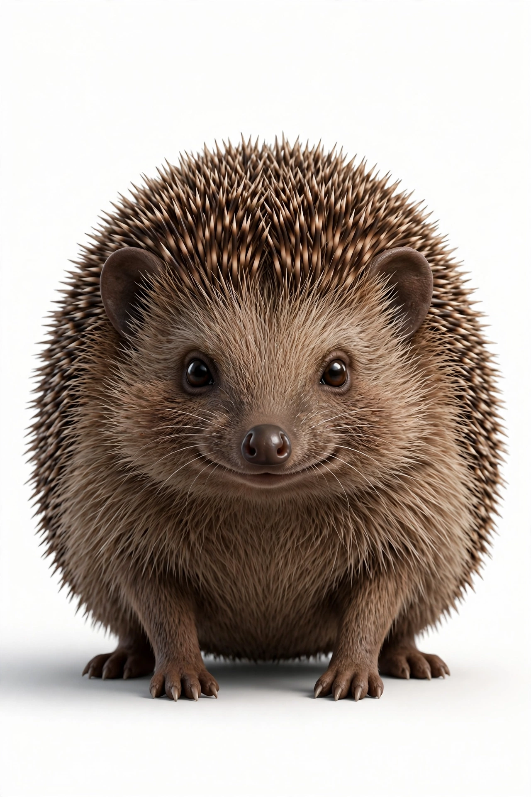
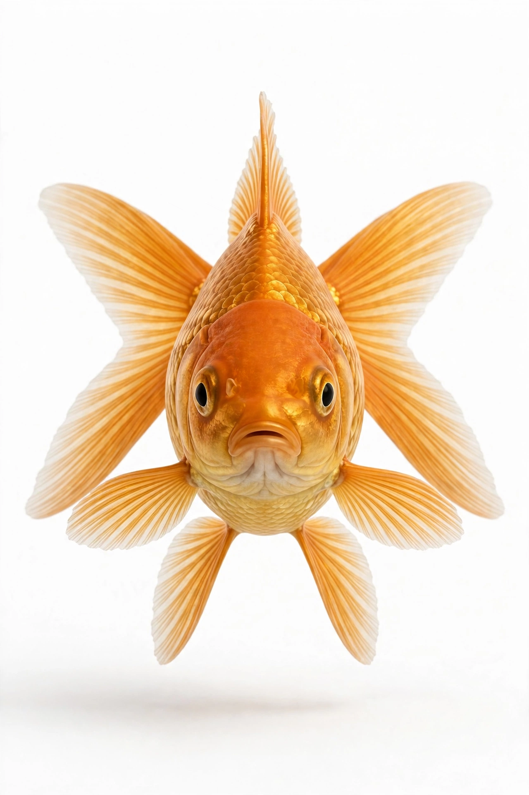

# 想清楚，说明白，写下来，教出去

> 冒个泡儿

星期二，我要讲一场汇报。这篇文章，就是拿那场汇报来练的。练什么？一件事：把脑子里的东西传到别人脑子里。传得好不好，不看你懂多少，看对方接住多少。负担越低，接得越稳。

这四步不挑工具。工具会换，流程和规矩不会——[《别问哪个工具好》](https://brew.zhangxunnj.com/docs/sparkling-007.html)里说过，重点在「善假」不在「物」，区别在记忆、工作流和治理三件事。这四步就是工作流和治理本身：想清楚、说明白、写下来、教出去。

## 一、为什么传不动：脑子装不下

人的工作记忆很小。米勒（1956）说一次能装 7 加减 2 个组块。后来的研究（Cowan，2001）说，处理新信息时其实只有 3 到 4 个。没复习的信息，20 秒左右就没了。长期记忆倒是几乎无限。

认知负荷理论（Sweller，1988）说，学习时的脑力负担分三种，都在抢同一块有限的工作记忆。内在负荷是材料本身的难度，拆不开，但可以排顺序：先讲简单的，再讲复杂的。外在负荷是讲法不好带来的负担——行话、杂乱、排版差、注意力被拆散，尽量去掉，它不帮学习，只占地方。相关负荷是真正用来建理解的脑力，把新东西连成体系、变成自己的，要留出空间保护它。这是学习真正发生的地方。

规矩就一条：去掉外在负荷，管住内在负荷，留出相关负荷。下面四步，都是按这条规矩走的。

## 二、想清楚：先把自己讲明白

想清楚用费曼学习法。费曼是个物理学家，得过诺贝尔奖。他最出名的一点，是能把很难的物理讲得很白。

他有句常被引用的话："如果你不能把一件事讲简单，说明你自己还没真懂。"这是后人转述的大意，不是他原话逐字记录。

后来有人把他讲东西的办法整理成四步：选一个概念，只选一个，不要一整章；用大白话讲出来，假装在教一个十二岁的小孩，不许用行话，不许看笔记；找出卡住的地方，讲到哪句卡住了、哪句只能用行话糊过去，哪里就是漏洞，回去翻书补上；再讲一遍，更简单，换更短的句子，加一个比方，能一口气讲顺，才算真懂了。

要点：费曼本人没写过这四步。这是后人整理的。名字最早出现在 2011 年（Scott Young 的一篇文章），2012 年 Farnam Street 的版本传开了。但这四步背后的东西是有研究的：主动回忆、自我解释、教别人，都有实验证据。

这个办法不是用来背东西的，是用来检验"我是不是真懂了"。费曼这套办法，换成中文就是一句话：用自己的嘴讲一遍，讲出来才算自己的。[《验证是地板》](https://brew.zhangxunnj.com/docs/sparkling-006.html)里管这叫发酵，也叫反刍——记忆也是生成型的，每次回忆都是一次重新生成，不讲出来，它就不是你的。验证是地板：讲不下去的地方，就是地板没铺好的地方。想不清楚，就没法替别人降低负担。先把自己讲明白，才能替别人省力。

## 三、说明白：把复杂变简单

说明白有两个办法：ELI5 和双重编码。

ELI5 是 "Explain Like I'm Five" 的缩写，意思是"像对五岁小孩那样解释"。2011 年 7 月 28 日，Reddit（一个美国大论坛）开了个叫 r/explainlikeimfive 的版块。规则很简单：不用行话。拿家里现成的东西打比方。用短句子。只讲"是什么"和"为什么"，不堆细节。

"五岁小孩能懂"，不是把读者当小孩，是给自己立个标准。讲到五岁小孩能听懂的程度，说明你真吃透了，任何行话的遮羞布都拆掉了。

双重编码是"多通道"背后的学问。1971 年，加拿大心理学家艾伦·派维奥（Allan Paivio）提出"双重编码理论"。脑子处理信息有两条路：一条管语言（文字、说话），一条管图象（画面、空间）。两条路各自存一份记忆，互相连着。同一个东西，同时走了两条路，记忆就存了两份，取的时候有两条路可走。只走一条路，只存一份。

证据有三条。第一，图像优于文字。1967 年，谢泼德（Shepard）给人看 612 张图，每张只看六秒，之后认图，正确率 98%。图比字好记得多，约两倍。第二，具体词比抽象词好记，具体词（比如"苹果"）比抽象词（比如"真理"）好记约两倍，因为具体词会自动带出一张图，抽象词带不出来。第三，文字加图比只有文字学得深。理查德·梅耶（Richard Mayer）做过多媒体学习研究。在 11 个对照实验里，文字加图组在迁移测试上平均好约 89%。迁移测试就是换个新问题，看还能不能用。

所以这篇文章配图，不是装饰，是按脑子的路子走的。文字是一条路，图是另一条路，两条路一起进，记得牢。

注意：双重编码不是"学习风格"（视觉型、听觉型、动觉型那一套）。学习风格测了上百次，没有证据说按风格教更有效。双重编码是对所有人都有效的办法。

下面是"说明白"的现场演示：狐狸、刺猬、金鱼、大象。

狐狸什么都想学一点，刺猬一辈子只练一招。狐狸像什么都想玩的小朋友，每个玩具都摸一下。刺猬像只玩一个最喜欢的玩具、玩得特别好的小朋友。

这句话很老了，有两千七百岁。很久很久以前，有个希腊诗人叫阿尔基洛科斯，他只留下一句话："狐狸知道很多事，刺猬只知道一件大事。"后来，一个叫伯林的人拿这句话写了一本书，叫《刺猬与狐狸》。他说人分成两种：一种像狐狸，什么都好奇，什么都学一点。一种像刺猬，一辈子只守住一个大本事。伯林自己后来也说，这本来只是个好玩的游戏，没想到大家都当真了。

金鱼不是只有 7 秒的记忆，大象记得很久很久以前的事。这一对，一真一假。

"金鱼只有 7 秒"是假的。你听到的数字一会儿是 3 秒，一会儿是 7 秒，一会儿是 10 秒。数字老是变，就说明没人真的量过。真正的金鱼记得好几个月。它记得什么时候吃饭、在哪里吃饭，就像你记得你的饭碗放在哪里一样，还认得喂它的人。

"大象从不忘记"是真的。大象的脑袋是陆地上最大的，有 5 公斤重。象群里年纪最大的奶奶象，记得几十年前去过的水源和老路。科学家发现：干旱的时候，跟着老奶奶象走的象群找到了水。跟着年轻母象走的象群，小象死了很多。

金鱼和大象这一对，[《大象与金鱼》](https://brew.zhangxunnj.com/docs/sparkling-002.html)里已经讲过：喂饱大象，拿金鱼去考它。大象记得一切，金鱼只认眼前——文档里没写清楚的，它一定会问；你想当然的地方，它一定会挑。说明白，就是先过金鱼这一关。

## 四、借假修真：假的东西也有真用处

金鱼这个例子正好说明一件事：打比方、用类比，都会有信息损失和偏差。

"金鱼只有 7 秒"是假的，没有研究支持，数字也对不上。但它传得非常好：人一听就懂，"金鱼=记性差"。它把"记性差"这个抽象的意思，一下子变成了一个画面。

类比就是这样。它一定丢东西、一定走样。它把复杂的东西压扁，压扁就会失真。但它传得快、记得牢。

记忆宫殿也是一个例子。它是不是一个"真正科学"的办法，可能不一定。但在历史上，它确实帮很多人真正改善了记忆。它的起源是个传说。两千五百年前，希腊诗人西蒙尼德斯（Simonides）在宴会上被叫出去，回来时屋顶塌了，宾客压得认不出来。他凭记忆里每个人坐的位置，认出了尸体。从此得出办法：把要记的东西变成画面，放在熟悉的一条路上，走一遍就能按顺序取回来。这故事是西塞罗（《论演说家》，公元前 55 年）讲的，离事发已四百多年。昆体良也讲过，还说作者们连这是谁的宴会都说不准。当传说听就好。

但它真的帮了很多人。罗马演说家靠它背长篇演讲。利玛窦（Matteo Ricci）1596 年把它写进《西国记法》带到中国。2017 年《神经元》杂志做过一个实验。普通人练六周，每天 30 分钟。72 个词的回忆从 26 个涨到 62 个。四个月后，大半还在。它的局限也很清楚：它帮你按顺序记清单、记演讲提纲，但它不帮你理解。它帮你回忆你已经懂的东西，不帮你懂。

记忆宫殿这个办法，两千五百年了还在用。[《AI 开始做梦了？》](https://brew.zhangxunnj.com/docs/sparkling-008.html)里说，机器做梦做的不是梦，是记忆的家务：回放、合并、纠正、补索引。人写下来、教出去，做的也是同一件家务——只不过我们是在替自己的脑子打扫。

所以"假"不是没用的。"借假修真"里的"假"，虽然不是"真"，但它通向"真"。它有它"真"的地方：它的"真"不在字面准不准，而在它能不能把人带到"真"那边去。这就是"假万物，成自己"。假（借）是路子，真（成自己）是去处。借得越准，去得越稳。金鱼这个"假"借得好，因为它把"记性"这个意思传出去了，传对了方向。

每一步都是通向更有效的办法的一步。记忆宫殿不是终极的，费曼学习法也不是，双重编码也不是。现在我们用的这些办法，也不敢说是终极的。它们只是通往更好办法的一步。这不是遗憾，是必然。我们永远站在"还不是终极"的位置上。借一个"还不是真"的办法，往真那边走一格。再借下一个，再走一格。终极的办法永远还没到。我们只能借暂时的、不完美的办法，一步一步往真靠近。借假，是我们唯一能前进的方式。所以"借假修真"不只是一个技巧，它是一个哲学上的必然。借之前分清真假，是为了借得干净。但分清之后，该借的"假"还是要借。怕失真就不借，就什么都传不出去。

## 五、写下来：把想法变成看得见的东西

写下来是把脑子里的东西变成别人看得见的东西。写的时候，含糊的地方藏不住，写不下去就是没想清楚。

写下来，就是把琢好的东西变成一份看得见的文档——002 里那份设计文档就是干这个用的：喂饱大象，拿金鱼去考它。文档写出来，金鱼才能考；考得过，想法才算站住了。

"Answer me with HTML" 是我们现在用的一个办法：把一个回答变成一页可视化 HTML 讲解。结论先行，配图、配表、配流程图，关系看得见。它降低负担的路子很直接：关系不用在脑子里攒着，图上直接画出来。流程、对比、层级，一眼就能看到。不用在字里行间自己拼，工作记忆省下来，用在真正理解上。这是"写下来"的升级版。不只是写字，是把结构写出来、画出来。

## 六、教出去：教别人是最好的学

教出去是最后一步，也是最狠的一步。教别人，逼你把东西组织好、讲简单、直面漏洞。教是最好的学。

六个有证据的办法，缩写叫 SIRDEC。上面讲了 D（双重编码），剩下五个在这里：间隔重复——把复习摊开来，不要一次突击，今天学，明天回看，几天后再回看（艾宾浩斯遗忘曲线，1885，上百次重复验证，分散复习比集中突击记得牢得多）；主动回忆——合上书，凭记忆默写、默讲、做题，不要只重读（Roediger 和 Karpicke，2006：做题自测的学生，一周后比只重读的同学多记住约一半）；交错练习——一次练几种题型，不要一种练到底再换一种（Rohrer 和 Taylor，2007：交错练数学题的学生，后来考试成绩明显更好，虽然练的时候觉得更难）；精细加工——多问"为什么""这和我已知的东西怎么连起来"；具体例子——抽象概念配一个具体例子，例子让抽象的东西落了地，好记、好用。

这六个办法可以一起用，效果更好。教的时候用上它们，学生记得住；自己教一遍，记得更牢。

教出去之前还有一道关：谁检查、谁兜底。007 里说的治理就是这个——没有这套东西，教得越多，错得越快。

## 七、结语

想清楚、说明白、写下来、教出去，这是一个循环。教出去之后，别人问的问题又会让你想得更清楚。想得更清楚，又能讲得更明白。

这篇文章本身就是一个示范。它用费曼学习法写：讲出来、卡住就查、再讲简单。它用 ELI5 的标准写：五岁小孩能懂。它用双重编码排：文字加图。它用一页 HTML 写下来。它现在要教出去。

"假"不是"真"的敌人。"假"是通向"真"的路。借假修真，假万物，成自己。

每一步都是通向更好办法的一步。没有终极的办法，只有下一步。借假修真，是一个哲学上的必然。

星期二，我拿这场汇报练一遍。你呢——最近一次把一件事真正讲明白，是什么时候？

---

出处一览
1. 认知负荷：John Sweller（1988）《Cognitive load during problem solving: Effects on learning》，Cognitive Science；Miller（1956）7±2；Cowan（2001）3–4 个组块。
2. 狐狸与刺猬：阿尔基洛科斯残篇 201 号；伊拉斯谟《格言集》（1500）拉丁文 Multa novit vulpes, verum echinus unum magnum；以赛亚·伯林《刺猬与狐狸》（Weidenfeld & Nicolson，1953）。
3. 金鱼：所谓"3 秒／7 秒记忆"无任何研究支持，数字不统一即为无测量之证；实测金鱼可记住训练关联至少三个月（普利茅斯大学，2003；Culum Brown，麦考瑞大学）。
4. 大象：大脑约 5 公斤，陆地最大；2008 年《生物学快报》：老母象带队象群渡过干旱，幼象死亡率 2%；年轻母象带队则达 63%。
5. 费曼学习法：Richard Feynman（1918–1988），1965 年诺贝尔物理学奖；四步法为后人整理，名字最早见 Scott Young 2011 年 9 月文章，Farnam Street 2012 年 4 月版本广为流传；机制研究见 Lachner 等人 2022 年综述（Educational Psychology Review）。
6. ELI5：Reddit r/explainlikeimfive，2011 年 7 月 28 日创建，成员两千多万；"六岁小孩"语常归于爱因斯坦，措辞各版本不同。
7. 双重编码：Allan Paivio《Imagery and Verbal Processes》（1971）；Shepard（1967）612 张图认图 98%；Richard Mayer 多媒体学习研究，11 个实验，迁移测试平均好约 89%。
8. 六个证据最强的办法：Dunlosky 等人（2013）《Psychological Science in the Public Interest》；Weinstein、Madan 与 Sumeracki（2018）；Roediger 与 Karpicke（2006）；Rohrer 与 Taylor（2007）；Ebbinghaus（1885）。
9. 借假修真、假万物：荀子《劝学》"善假于物"；"借假修真"为借的谱系中的一环；品牌 tagline"假万物，成自己"。
10. 记忆宫殿：Simonides 传说（Cicero《De Oratore》II.86；Quintilian《Institutio Oratoria》XI.2；《Rhetorica ad Herennium》III.16–24）；Matteo Ricci《西国记法》（1596）；Maguire 等人（2003）Nature Neuroscience；Dresler 等人（2017）Neuron；Twomey 与 Kroneisen（2021）meta-analysis；Dunlosky 等人（2013）评 imagery mnemonics 为低效用（一般文本学习）。

本文由 AI 辅助写作。素材、结构与观点来自作者，文字由 AI 起草、作者改定。
